<div align="center">

# CodeBridge

**Run and supervise coding sessions on your own Mac or PC, from your phone, from anywhere.**

No account. No server to rent. Scan a QR code and you're connected.

[](LICENSE)
[](apps/ios)
[](apps/android)
[](apps/mac-agent)

<br />

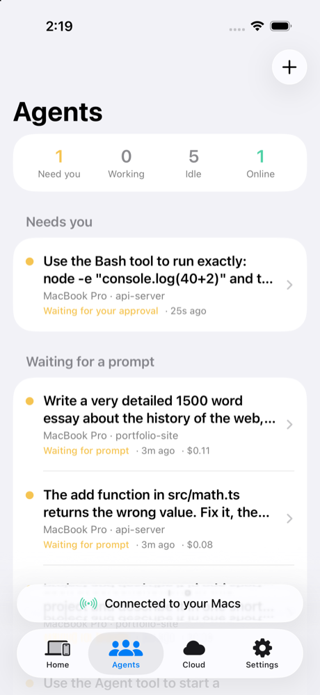
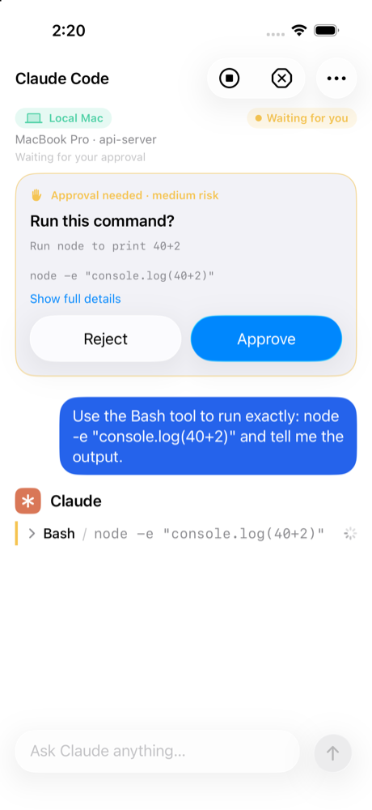
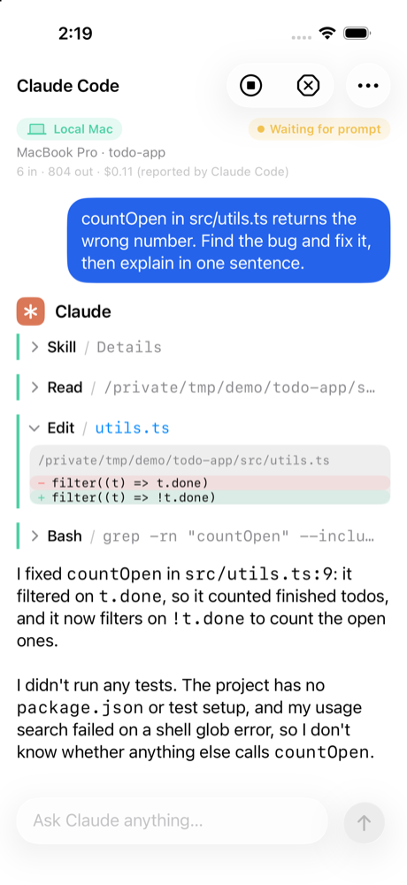
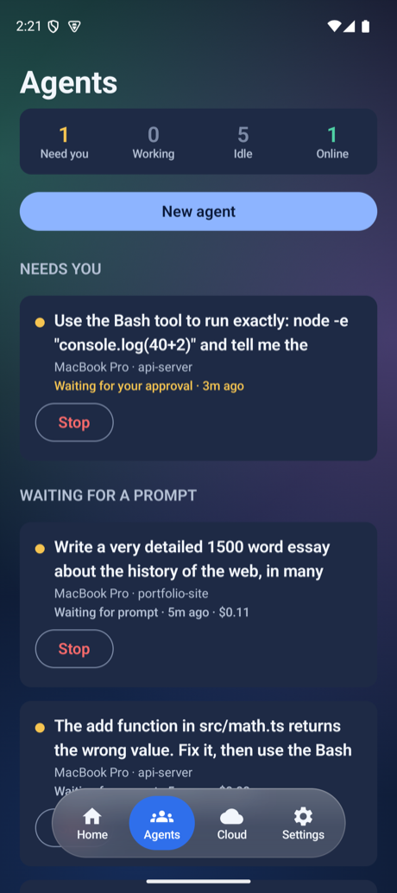

</div>

---

## What it is

CodeBridge puts **Claude Code**, a terminal and git for your own computer in your pocket. Start a session on your Mac or Windows PC, watch it work, approve the commands it asks about, and walk away.

- **Several agents at once.** The **Agents** tab shows every Claude Code session across your computers, which ones need you, and lets you cancel, stop or start more. Subagents Claude starts show as their own cards.
- **Approve from your phone.** Anything Claude Code is not allowed to run on its own appears as an **Approve / Reject** card with the exact command. Nothing runs until you tap Approve.
- **A real Claude Code chat.** Replies, tool calls, file edits as red and green lines, and screenshots from your project all show in the conversation.
- **Pick up where you left off.** **Continue** lists the Claude Code conversations already saved on your computer, including ones you started in a terminal, and resumes one from the phone, in place or as a copy.
- **Any project, even on an external drive.** Add an existing folder, start a new one, or choose where new projects go.
- **Your code stays on your computer.** Commands run on your machine, inside folders you approved there. Your phone only receives what you ask to see: output, diffs and images, sent through your own relay. Optional cloud sessions run in an isolated Anthropic sandbox and are always labelled.
- **No account, no server to rent.** You run your own relay, and the QR code it shows is the whole sign-in.
- **Your Claude plan works.** Claude Code runs on your computer with its own login, so sessions use your own Claude subscription. CodeBridge never sees that login.

## Get started

You need three things: a relay (the small program that links phone and computer), the agent on your computer, and the app on your phone.

### 1. Start your relay and connect your computer

On the computer you want to control (Node.js 22+, and Claude Code installed if you want Claude sessions):

```bash
npx -y codebridge-relay start --tunnel cloudflare --with-agent
```

This starts the relay, opens a free secure public address through Cloudflare (install [`cloudflared`](https://developers.cloudflare.com/cloudflare-one/connections/connect-networks/downloads/) first), joins this computer, and prints a **QR code**. Prefer a permanent address? Use your own Fly.io account instead (about $2 a month):

```bash
npx -y codebridge-relay fly --with-agent
```

The app has a **Set up a relay** screen with both commands, a Copy button and a _Send to my computer_ button. To keep the agent running after you close the terminal, install it and start it at login:

```bash
npm install -g codebridge-agent
codebridge-agent service install        # LaunchAgent on macOS, scheduled task on Windows
```

### 2. Install the app and scan

<table>
  <tr>
    <td><b>Android</b></td>
    <td>Download <a href="releases/CodeBridge-0.4.0.apk"><code>CodeBridge-0.4.0.apk</code></a> (signed) and open it. Android asks once to allow installs from your browser or files app.</td>
  </tr>
  <tr>
    <td><b>iOS</b></td>
    <td>Build from source in Xcode, or use <a href="releases/CodeBridge-0.4.0.ipa"><code>CodeBridge-0.4.0.ipa</code></a> on a registered device. See <a href="#ios-installation">iOS installation</a>.</td>
  </tr>
</table>

Open the app, tap **Scan QR code**, scan the code from step 1, confirm the relay, done. Your computer shows up as **Online**.

### 3. Work from your phone

| To do this                           | Do this                                                                                                                     |
| ------------------------------------ | --------------------------------------------------------------------------------------------------------------------------- |
| Start Claude Code on a project       | Home → your computer → a project → **New session** → _Claude Code_                                                          |
| Pick up an earlier conversation      | On a project, tap **Continue**, choose a conversation, then _Continue_ or _Continue as a copy_                              |
| Work on a folder that already exists | Your computer → **Add existing folder**, browse and choose **Use this folder**                                              |
| Start a brand-new project            | Your computer → **New project**, type a name (optionally with `git init`). **Change default folder** picks where it goes    |
| See everything that is running       | The **Agents** tab: _Needs you_, _Working_, _Idle_. Swipe or tap to cancel a turn, stop a session, or start a **New agent** |
| Approve a command Claude asked about | Tap **Approve** or **Reject** on the card. No answer for 10 minutes counts as Reject                                        |
| Add another computer                 | Home → **Add a computer**                                                                                                   |

Claude Code can edit files in the project on its own, and asks you about anything else. Terminal and git sessions use presets; custom commands and interactive shells are off until you turn them on (see [Settings on the computer](#settings-on-the-computer)).

## Screenshots

<table>
  <tr>
    <th align="center">Set up a relay</th>
    <th align="center">Home</th>
    <th align="center">Settings</th>
  </tr>
  <tr>
    <td>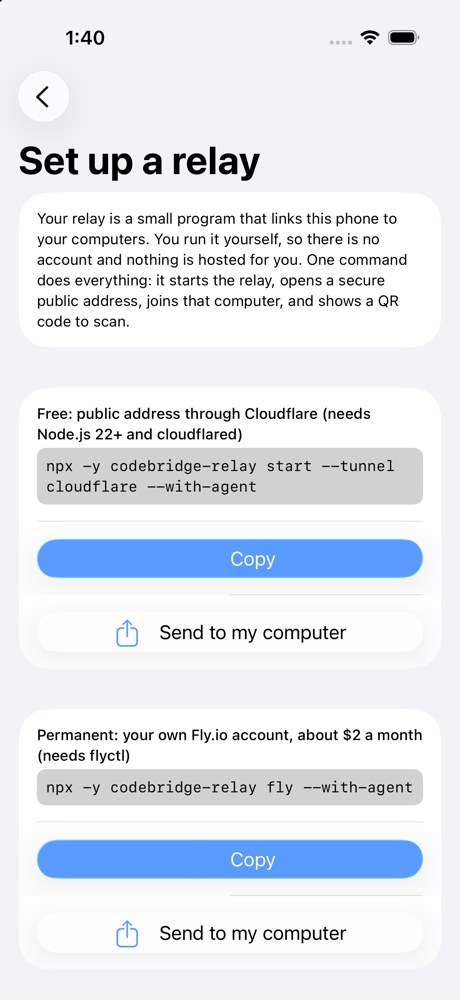</td>
    <td>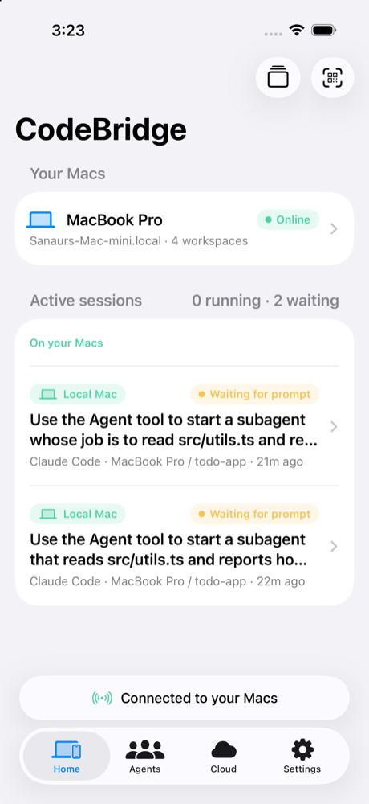</td>
    <td>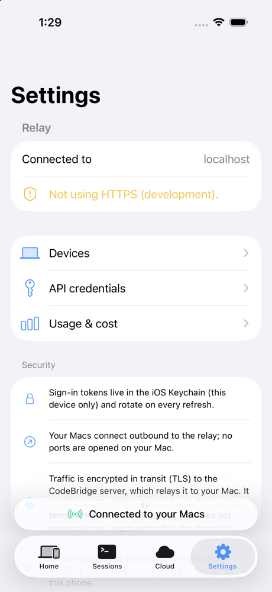</td>
  </tr>
  <tr>
    <td colspan="3" align="center"><sub><b>iOS 26</b>: native SwiftUI with Liquid Glass</sub></td>
  </tr>
  <tr>
    <td>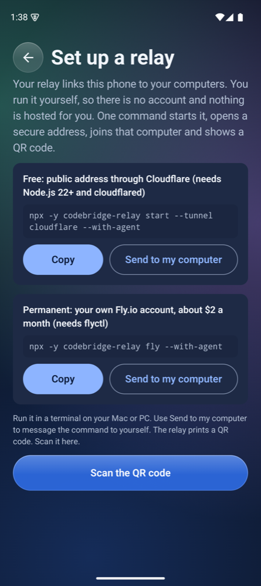</td>
    <td>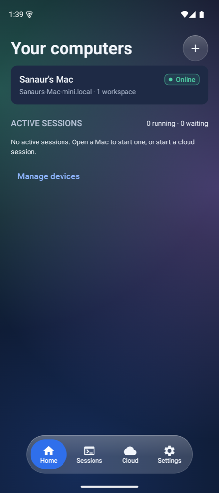</td>
    <td>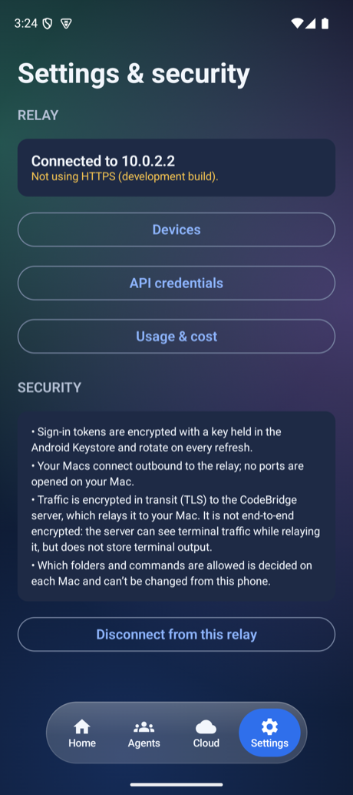</td>
  </tr>
  <tr>
    <td colspan="3" align="center"><sub><b>Android</b>: Jetpack Compose with a glass control layer</sub></td>
  </tr>
</table>

### Agents, chat and approvals

<table>
  <tr>
    <th align="center">Agents</th>
    <th align="center">Approve a command</th>
    <th align="center">Chat with Claude Code</th>
  </tr>
  <tr>
    <td align="center"></td>
    <td align="center"></td>
    <td align="center"></td>
  </tr>
  <tr>
    <td align="center"></td>
    <td align="center">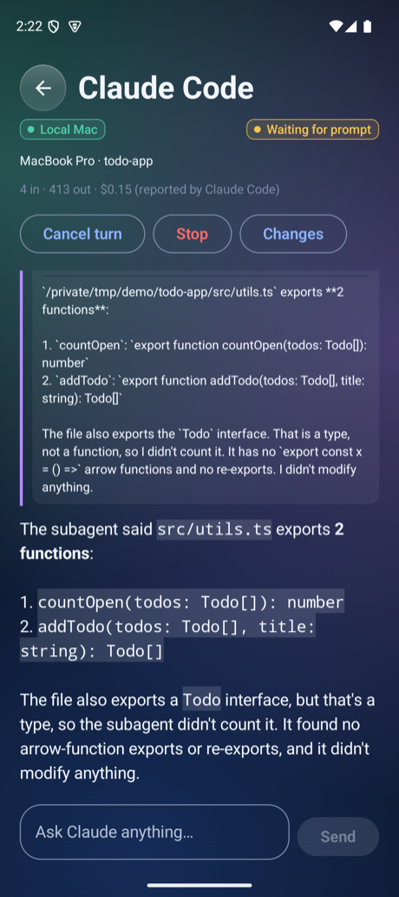</td>
    <td align="center">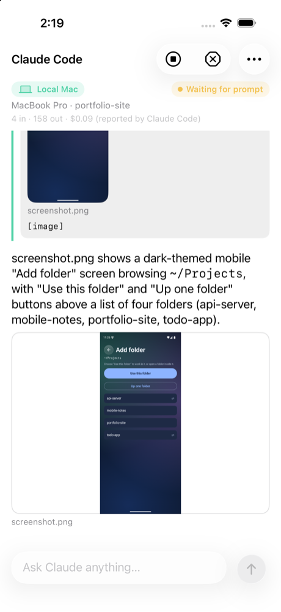</td>
  </tr>
  <tr>
    <td colspan="3" align="center"><sub>The <b>Agents</b> tab shows every Claude Code session and which ones need you. Commands Claude Code is not allowed to run on its own appear as an approval card. Subagents get their own card with the steps they took, and screenshots from your project show right in the chat.</sub></td>
  </tr>
</table>

### Folders and conversations

<table>
  <tr>
    <td align="center">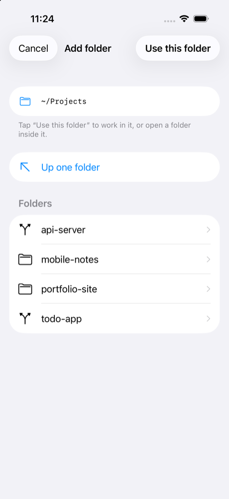</td>
    <td align="center">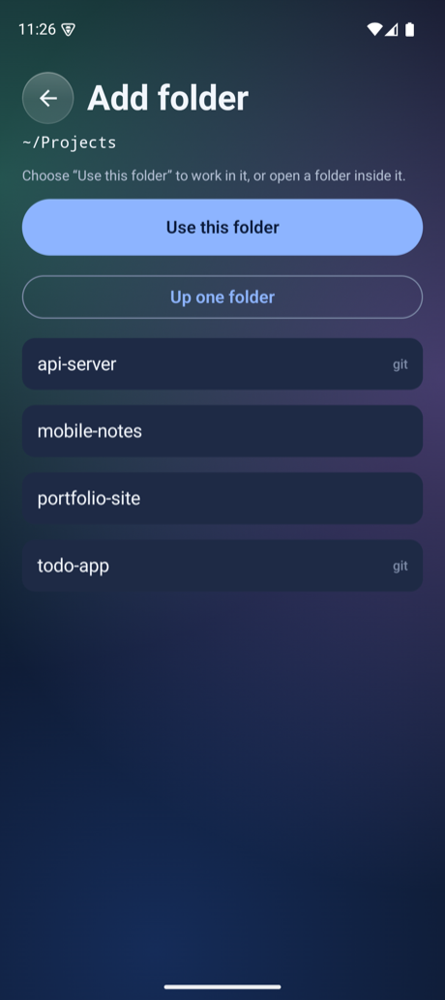</td>
    <td align="center">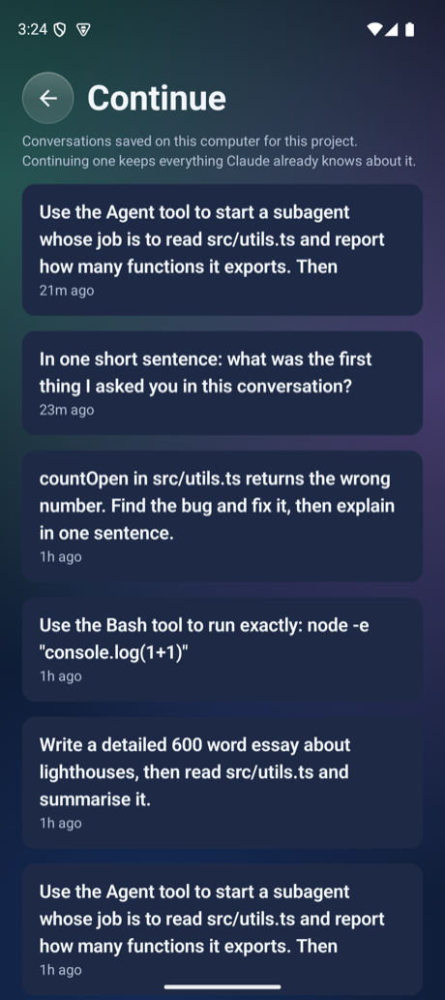</td>
  </tr>
  <tr>
    <td colspan="3" align="center"><sub><b>Add existing folder</b> and <b>Change default folder</b> browse your computer; hidden and system folders are never offered. <b>Continue</b> lists the Claude Code conversations saved for a project.</sub></td>
  </tr>
</table>

## How it works

```
   ┌───────────────┐        HTTPS + WSS         ┌─────────────────────┐      WSS, outbound       ┌───────────────────────┐
   │  Your phone   │ ─────────────────────────▶ │   Your relay        │ ◀─────────────────────── │  Your Mac or PC       │
   │  iOS · Android│ ◀───────────────────────── │   one process, your │ ───────────────────────▶ │  codebridge-agent     │
   └───────────────┘   live output, approvals   │   own address       │   commands (re-checked   │  terminal · git ·     │
                                                └─────────────────────┘   on the computer)       │  Claude Code          │
                                                                                                  └───────────────────────┘
```

1. The **agent** on your computer connects **outbound** to your relay. No ports are opened on your computer.
2. The **relay** forwards messages between your phone and your agent. It is one small process with an embedded database, run by you.
3. The **phone** joins by scanning the relay's QR code, which carries a random secret. That secret is stored in the iOS Keychain or Android Keystore and silently reconnects after a restart.
4. **Claude Code** runs on the computer through the `claude` CLI. When it needs permission, the agent asks your phone and passes the answer back; each permission is one command, never "always allow".

Every command is checked again on the computer against the policy you set there, so a compromised relay or phone cannot widen what is allowed.

## Safety

|                   |                                                                                                                                                                                                                 |
| ----------------- | --------------------------------------------------------------------------------------------------------------------------------------------------------------------------------------------------------------- |
| **Folders**       | Only registered folders are reachable. From the phone you can pick one inside your home folder, or inside a place you added on the computer; never hidden or system folders. Paths are symlink-safe.            |
| **Claude Code**   | Edits inside the project go through; anything else needs your **Approve** on the phone. `sudo`, `dd`, `shutdown` and the like are refused without asking, and `rm`, `curl` and `git push` are marked high risk. |
| **Commands**      | Terminal commands from the phone are limited to presets unless you turn on custom commands. Some programs (`sudo`, `diskpart`, `reg`, …) never run.                                                             |
| **Shells**        | Interactive shells are off until you enable them on the computer.                                                                                                                                               |
| **Images**        | Only png, jpg, gif and webp files inside the project, up to 6 MB, are sent to the phone. SVG is never served, and secret-looking files are refused.                                                             |
| **Conversations** | Only the saved conversations for that exact project can be listed or resumed. The phone gets text only, with secrets redacted.                                                                                  |
| **Secrets**       | Stored in the OS credential store (Keychain, Credential Manager, Android Keystore). Child processes get a minimal environment.                                                                                  |
| **Relay link**    | The QR code is a password: it gives full control of every computer on that relay. Don't share a screenshot of it.                                                                                               |
| **Confirmation**  | Opening a connect link asks you to confirm the relay before anything is sent to it.                                                                                                                             |

Read [docs/SECURITY.md](docs/SECURITY.md) for the full threat model.

### Settings on the computer

The owner decides what the phone may do, on the computer. Nothing here can be changed from the phone.

```bash
codebridge-agent status                                   # show pairing, projects and every setting below
codebridge-agent policy set <name> <true|false>           # change a switch
codebridge-agent policy set projectsRoot <dir>            # where new projects are created
codebridge-agent policy add-root <dir>                    # let the phone browse another place, such as an external drive
codebridge-agent policy remove-root <dir>
codebridge-agent workspace add <dir>                      # register a project folder from the computer
```

| Switch                     | Default | What it controls                                                    |
| -------------------------- | ------- | ------------------------------------------------------------------- |
| `allowClaudeCode`          | on      | Claude Code sessions, and listing or continuing saved conversations |
| `allowClaudeCodeEdits`     | on      | Claude Code changes files in the project without asking             |
| `allowClaudeCodeApprovals` | on      | Ask on the phone about anything else, instead of declining it       |
| `allowWorkspaceCreation`   | on      | **New project** and choosing the default project folder             |
| `allowFolderBrowse`        | on      | **Add existing folder** and browsing your computer from the phone   |
| `allowCustomCommands`      | off     | Custom terminal commands, beyond the presets                        |
| `allowInteractiveShell`    | off     | A login shell, which is equivalent to full shell access             |

#### Projects on an external drive

By default the phone browses your home folder. To reach projects on another drive, add its location on the computer:

```bash
codebridge-agent policy add-root /Volumes/SSD/Code      # macOS; on Windows: D:\Code
```

The drive then appears at the top of **Add existing folder**. The same rules apply inside it, and the drive itself can't be added as a project, only a folder inside it. An unplugged drive is skipped.

## Platforms

| Component       | Where                                            | Notes                                                                                                                    |
| --------------- | ------------------------------------------------ | ------------------------------------------------------------------------------------------------------------------------ |
| **Agent**       | macOS 13+, Windows 10 (1809) / 11                | `npm install -g codebridge-agent`. Starts at login through a LaunchAgent (macOS) or a per-user scheduled task (Windows). |
| **Relay**       | Any computer with Node.js 22+, Docker, or Fly.io | `codebridge-relay`, or the container image. Embedded Postgres, no database server.                                       |
| **iOS app**     | iOS 26+                                          | SwiftUI, Liquid Glass, VisionKit QR scanning.                                                                            |
| **Android app** | Android 9+ (API 28)                              | Jetpack Compose, Keystore-encrypted secrets, Google code scanner.                                                        |

Update the agent and relay together (`npm install -g codebridge-agent@latest codebridge-relay@latest`): newer app features, such as subagents and images, need both.

### iOS installation

iOS only installs apps that Apple has signed for your device. Your options:

- **Build it yourself** (free): open `apps/ios/CodeBridge.xcodeproj` in Xcode 26, choose your device and Apple ID under _Signing & Capabilities_, and run. A free Apple ID's builds last 7 days.
- **The `.ipa` in [`releases/`](releases)** is signed with a development certificate and installs only on the devices registered in its provisioning profile. Everyone else needs to build it, or sideload it with a tool that re-signs it with their own Apple ID.
- **TestFlight or the App Store** is the way to reach everyone else. It requires an Apple Developer Program membership ($99 a year), which the project owner would set up.

### Verify a download

```bash
cd releases && shasum -a 256 -c SHA256SUMS
```

The APK is signed with the project's release key. Check its certificate with
`apksigner verify --print-certs CodeBridge-0.4.0.apk`.

## Under the hood

```
apps/
  api/          codebridge-relay: Fastify relay + WebSocket hub + embedded or external Postgres
  mac-agent/    codebridge-agent: pairing, terminals, git, Claude Code provider, autostart (macOS · Windows)
  ios/          SwiftUI app + the CodeBridgeKit Swift package
  android/      Jetpack Compose app (:app) and a pure-Kotlin core (:core)
packages/
  protocol/     zod schemas for every message that crosses a trust boundary
  shared/       secret redaction, terminal model, connect links, backoff
docs/           ARCHITECTURE, SECURITY, API, DEVELOPMENT, DEPLOYMENT, PLAN
infra/          relay.Dockerfile, docker-compose.yml
```

### Run from source

```bash
pnpm install && pnpm build

pnpm --filter codebridge-relay relay start                    # relay on http://localhost:8080
codebridge-agent connect '<link the relay prints>'            # or: pnpm --filter codebridge-agent exec tsx src/cli.ts connect '<link>'
open apps/ios/CodeBridge.xcodeproj                            # Xcode 26+
cd apps/android && ./gradlew :app:installDebug                # Android SDK 36; the emulator reaches the host at 10.0.2.2
```

### Tests

```bash
pnpm test                                          # protocol, shared, relay (Postgres or embedded), agent
swift test --package-path apps/ios/CodeBridgeKit   # iOS core
cd apps/android && CODEBRIDGE_JVM_ONLY=1 ./gradlew :core:test
pnpm lint && pnpm typecheck && pnpm format:check
```

The relay's suite runs against both real Postgres and the embedded database. CI also runs the agent on Windows.

### Shared relay with accounts

Teams can still run one shared relay with email accounts (`RELAY_MODE=multi`, `codebridge-relay serve`). See [docs/DEPLOYMENT.md](docs/DEPLOYMENT.md).

## Billing

- **Terminal and git sessions** cost nothing beyond your own computer.
- **Claude Code sessions** use whatever the `claude` CLI is signed in with on your computer, normally your Claude plan. CodeBridge never reads those credentials.
- **Cloud sessions** (optional) use Anthropic Managed Agents with an API key you provide, billed to that key.
- **Your relay** costs nothing on your own computer, or about $2 a month on Fly.io.

## Contributing

Issues and pull requests are welcome. Please run `pnpm lint && pnpm typecheck && pnpm test` first, and see [docs/DEVELOPMENT.md](docs/DEVELOPMENT.md).

## License

[MIT](LICENSE) © 2026 iamsanaur
